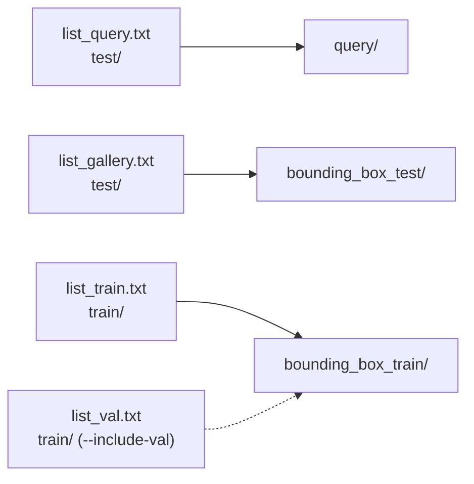

# msmt17-converter

**MSMT17 V1**(`list_*.txt` + `train/` + `test/`)을 **Market-1501 폴더 형식**(`query/`, `bounding_box_test/`,
`bounding_box_train/`, 파일명 `{pid:04d}_c{cam}_{원래이름}.jpg`)으로 바꾸는 외부 패키지 없는 작은 도구입니다. 코드만 있고 이미지는 없습니다.

[English README](README_en.md)



## 해결하는 문제
대부분의 Re-ID 코드(CLIP-ReID, PersonViT/TransReID, 평가 스크립트)는 Market-1501 형식을 읽고 파일명에서 ID와 카메라를
꺼냅니다. MSMT17 V1은 경로와 ID가 적힌 목록 파일로 배포되므로, 목록의 모든 이미지를 Market 형식으로 옮겨 같은 로더를 그대로 쓰게 합니다.

## 방법
| 단계 | 내용 |
|---|---|
| 1. 읽기 | `lists.py`가 `list_query/gallery/train[/val].txt`(`<상대경로> <pid>`)를 읽음 |
| 2. 이름 | `naming.py`: 카메라 = 원래 파일명의 세 번째 `_` 필드(`01`..`15` → `1`..`15`), 결과 이름 `{pid:04d}_c{cam}_{원래이름}` |
| 3. 계획 | `convert.py`: query/gallery는 `test/`, train/val은 `train/`에서 찾고, 이름 중복과 원본 누락을 검사 |
| 4. 배치 | `copy`(기본, `shutil.copy2`), `hardlink`, `symlink`; `--dry-run`은 아무것도 쓰지 않음 |
| 5. 확인 | 출력 폴더를 다시 읽어 폴더별 이미지 수 / ID 수 / 카메라 범위를 출력 |

`list_val.txt`는 기본적으로 합치지 않습니다(표준 MSMT17 V1 학습 세트 30,248장과 일치).

## 설치 / 데이터 / 실행
```bash
pip install -e .            # 표준 라이브러리만 사용; 테스트용 pytest: pip install -r requirements.txt
pytest
```

**데이터.** MSMT17은 저자가 비상업적 연구 목적으로, 자체 이용 조건에 따라 배포합니다. 공식 경로(MSMT17 / PTGAN 프로젝트
페이지의 신청 양식)로 받으세요. 이 저장소는 이미지나 목록 파일을 재배포하지 않습니다.

```bash
# 계획만: 폴더별 개수와 카메라 범위 출력, 파일은 쓰지 않음
python -m msmt17_converter --src data/MSMT17_V1 --dst data/msmt17_market --dry-run

# 변환(기본은 복사) 후 확인
python -m msmt17_converter --src data/MSMT17_V1 --dst data/msmt17_market
python -m msmt17_converter --src data/MSMT17_V1 --dst data/msmt17_market --link hardlink --include-val

# 기존 변환 폴더와 파일명 비교(불일치가 있으면 종료 코드 1)
python -m msmt17_converter --src data/MSMT17_V1 --dst data/msmt17_market --dry-run --compare data/msmt17_market
```
`--src`는 `list_train.txt`, `list_val.txt`, `list_query.txt`, `list_gallery.txt`, `train/`, `test/`가 있는 폴더입니다.
이미 있는 파일은 `--overwrite`를 주지 않으면 건너뜁니다.

## 폴더 구조
```
msmt17-converter/
├── src/msmt17_converter/
│   ├── lists.py      # list_*.txt 읽기, 분할 정의
│   ├── naming.py     # 카메라 번호와 Market 형식 이름
│   ├── convert.py    # 계획 / copy|hardlink|symlink / 확인 / 비교
│   └── __main__.py   # 명령줄
├── tests/            # tmp_path에 만드는 작은 가짜 MSMT17 트리
├── pyproject.toml
└── requirements.txt
```

## 인용 / 라이선스 / 관련 저장소
- MSMT17: L. Wei, S. Zhang, W. Gao, Q. Tian. *Person Transfer GAN to Bridge Domain Gap for Person Re-Identification.* CVPR 2018.
- Market-1501 형식: L. Zheng et al. *Scalable Person Re-identification: A Benchmark.* ICCV 2015.
- 코드: MIT 라이선스(`LICENSE`). 데이터셋은 이 라이선스의 대상이 아닙니다.
- 관련 저장소: [2026_석사논문_ReID_평가벤치](../2026_석사논문_ReID_평가벤치/),
  [2026_석사논문_ReID_카메라특징보정](../2026_석사논문_ReID_카메라특징보정/),
  [2026_석사논문_보행방향분석](../2026_석사논문_보행방향분석/),
  [2026_석사논문_재현가능한_Diffusion생성](../2026_석사논문_재현가능한_Diffusion생성/),
  [2026_석사논문_카메라별_자세선정](../2026_석사논문_카메라별_자세선정/),
  [2026_석사논문_MSMT17_변환기](../2026_석사논문_MSMT17_변환기/)
