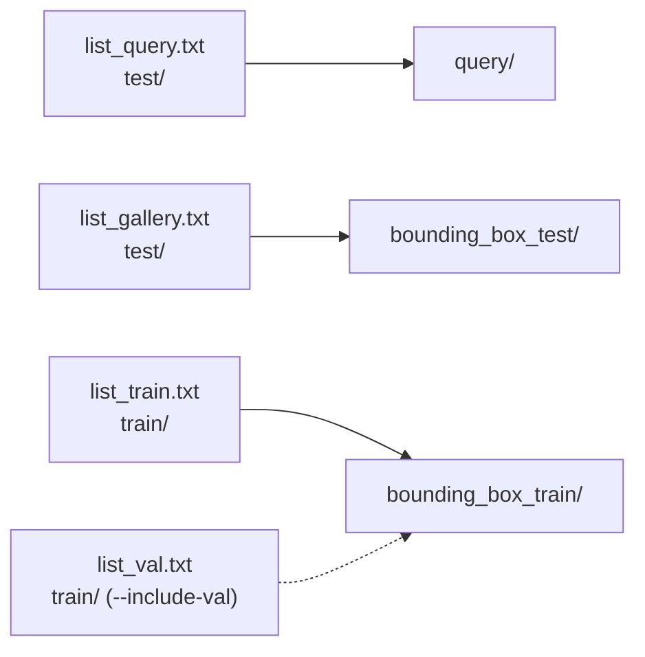

# msmt17-converter

Small, dependency-free utility that converts **MSMT17 V1** (`list_*.txt` + `train/` + `test/`) into the
**Market-1501 folder layout** (`query/`, `bounding_box_test/`, `bounding_box_train/`) with file names
`{pid:04d}_c{cam}_{original_name}.jpg`. Code only — no images are included.

[한국어 README](README.md)



## Problem
Most Re-ID code (CLIP-ReID, PersonViT/TransReID, evaluation scripts) reads the Market-1501 layout and
parses `pid` and camera from the file name. MSMT17 V1 instead ships list files with paths and ids. This
tool places every listed image into the Market layout so the same loaders work unchanged.

## Method
| Step | What happens |
|---|---|
| 1. parse | `lists.py` reads `list_query/gallery/train[/val].txt` (`<relative path> <pid>`) |
| 2. name | `naming.py`: camera = 3rd `_` field of the original name (`01`..`15` → `1`..`15`); target `{pid:04d}_c{cam}_{basename}` |
| 3. plan | `convert.py` maps query/gallery to `test/`, train/val to `train/`, checks for duplicate names and missing sources |
| 4. place | `copy` (default, `shutil.copy2`), `hardlink` or `symlink`; `--dry-run` writes nothing |
| 5. verify | scans the output and prints images / ids / camera range per folder |

`list_val.txt` is **not** merged by default, which matches the standard MSMT17 V1 train set of 30,248 images.

## Install / data / run
```bash
pip install -e .            # standard library only; pytest for tests: pip install -r requirements.txt
pytest
```

**Data.** MSMT17 is distributed by its authors for non-commercial research under their own terms of use.
Obtain it from the official source (request form on the MSMT17 / PTGAN project page); this repository does not
redistribute any images or list files.

```bash
# plan only: counts per folder and camera range, nothing written
python -m msmt17_converter --src data/MSMT17_V1 --dst data/msmt17_market --dry-run

# convert (copy is the default), then verify
python -m msmt17_converter --src data/MSMT17_V1 --dst data/msmt17_market
python -m msmt17_converter --src data/MSMT17_V1 --dst data/msmt17_market --link hardlink --include-val

# check names against an existing converted tree (exit code 1 on any mismatch)
python -m msmt17_converter --src data/MSMT17_V1 --dst data/msmt17_market --dry-run --compare data/msmt17_market
```
`--src` is the folder that contains `list_train.txt`, `list_val.txt`, `list_query.txt`, `list_gallery.txt`, `train/`, `test/`.
Existing target files are skipped unless `--overwrite` is given.

## Layout
```
msmt17-converter/
├── src/msmt17_converter/
│   ├── lists.py      # list_*.txt parsing, split definitions
│   ├── naming.py     # camera id and Market-style names
│   ├── convert.py    # plan / copy|hardlink|symlink / verify / compare
│   └── __main__.py   # CLI
├── tests/            # synthetic miniature MSMT17 tree in tmp_path
├── pyproject.toml
└── requirements.txt
```

## Citation / license / related
- MSMT17: L. Wei, S. Zhang, W. Gao, Q. Tian. *Person Transfer GAN to Bridge Domain Gap for Person Re-Identification.* CVPR 2018.
- Market-1501 layout: L. Zheng et al. *Scalable Person Re-identification: A Benchmark.* ICCV 2015.
- Code: MIT License (see `LICENSE`). The dataset itself is not covered by this license.
- Related repositories: [2026_석사논문_ReID_평가벤치](../2026_석사논문_ReID_평가벤치/),
  [2026_석사논문_ReID_카메라특징보정](../2026_석사논문_ReID_카메라특징보정/),
  [2026_석사논문_보행방향분석](../2026_석사논문_보행방향분석/),
  [2026_석사논문_재현가능한_Diffusion생성](../2026_석사논문_재현가능한_Diffusion생성/),
  [2026_석사논문_카메라별_자세선정](../2026_석사논문_카메라별_자세선정/),
  [2026_석사논문_MSMT17_변환기](../2026_석사논문_MSMT17_변환기/)
