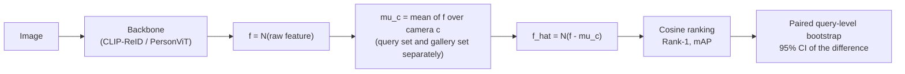

# reid-camera-calibration

**Training-free camera calibration for person re-identification: subtract each camera's mean feature at retrieval time to reduce camera bias, and compare the effect on seen (same-domain) and unseen (cross-domain) cameras.**

[한국어 README](README_ko.md)

## Problem

A Re-ID model embeds every image of a camera with a shared camera-specific offset (lighting, viewpoint, background, colour response). On cameras the model was trained on, this offset is largely learned away; on cameras it has never seen (cross-domain), images of *different* people from the same camera can end up closer than images of the *same* person from different cameras. This repository measures how much of that gap a simple retrieval-time correction recovers, without any training or labels.

## Method

Camera-mean subtraction (Song et al., ICLR 2025), applied after feature extraction:



| Step | Module | What it does |
|---|---|---|
| 1. Feature extraction | `reid_calib.extract` | CLIP-ReID ViT-B/16 or PersonViT ViT-B/16, global feature before BNNeck, raw float32, cached as `.npz` |
| 2. Calibration | `reid_calib.calibrate` | `f_hat = N(f - mu_c)`, `f = N(raw)`; `mu_c` is the per-camera mean, computed **separately** for the query set and the gallery set; only camera ids are used |
| 3. Evaluation | `reid_calib.evaluate` | standard protocol: same-pid **and** same-camera gallery images removed per query; Rank-1, mAP |
| 4. Statistics | `reid_calib.stats` | paired query-level bootstrap (1,000 resamples, seed 0) of per-query AP / Rank-1 difference, 95 % CI, `*` if it excludes 0 |

After the subtraction (before the final normalisation) every camera's mean feature is exactly zero; this is the invariant tested in `tests/test_calibrate.py`.

## Installation

```bash
git clone https://github.com/artelee/IndustrialAI.git
cd IndustrialAI/2026_석사논문_ReID_카메라특징보정
pip install -r requirements.txt          # numpy, pyyaml, pytest: enough for calibration / evaluation / tests
pip install -e .                         # optional: import reid_calib from anywhere
pytest                                   # CPU only, synthetic data
```

Feature extraction additionally needs PyTorch, torchvision, Pillow and the requirements of the backbone's own repository (`pip install -e ".[extract]"` plus e.g. `pip install -r third_party/CLIP-ReID/requirements.txt`). The figure needs matplotlib (`pip install -e ".[plot]"`).

### Data and weights (links only, nothing is redistributed here)

* **Datasets**: [Market-1501](https://zheng-lab-anu.github.io/Project/project_reid.html), DukeMTMC-reID (withdrawn by its authors; use only a copy you are licensed to use). Obtain them from the official sources under their licenses. Put them at `data/market1501/` and `data/dukemtmc-reid/` (each with `query/` and `bounding_box_test/`) or edit `configs/{market,duke}.yaml` / pass `--data-root market <path>`.
* **CLIP-ReID** code and ViT-B/16 checkpoints: <https://github.com/Syliz517/CLIP-ReID> → clone to `third_party/CLIP-ReID`, weights to `weights/clipreid/` (paths in `configs/backbones/clipreid.yaml`). The upstream code downloads the OpenAI CLIP ViT-B/16 weights on first use.
* **PersonViT** code: <https://github.com/hustvl/PersonViT> → clone to `third_party/PersonViT`; pretrained ViT-B/16 <https://huggingface.co/lakeAGI/PersonViT> and Re-ID fine-tuned checkpoints <https://huggingface.co/lakeAGI/PersonViTReID> → `weights/personvit/` (paths in `configs/backbones/personvit.yaml`).

The model code is imported from your checkout (`repo:` in the backbone config, or `--repo`); it is not copied into this repository. The upstream CLIP-ReID code moves the model to CUDA internally, so CLIP-ReID extraction needs a GPU; PersonViT extraction also runs with `--device cpu` (slow). Calibration, evaluation and statistics never need a GPU or torch.

### Run

```bash
# CLIP-ReID trained on Duke, evaluated on Market: Base vs. + calibration with bootstrap CI.
# Uses outputs/features/clip_duke_market_{query,gal}.npz if present, otherwise extracts them (GPU).
python scripts/run_eval.py --backbone clipreid --train duke --eval market --calib

# all 8 settings (2 backbones x same/cross domain) from an existing feature cache (CPU, ~1-2 min in total)
python scripts/run_eval.py --backbone clipreid personvit --train market duke --eval market duke \
    --calib --features data/features

# bar chart of your own run
python scripts/plot_results.py --table outputs/results/summary.json --out outputs/calibration_map.png
```

Outputs (in `outputs/results/`, git-ignored): `<backbone>_<train>_<eval>.json` (Rank-1 / mAP for both conditions and the CIs), `<backbone>_<train>_<eval>_per_query.npz` (per-query AP and Rank-1), `summary.md`, `summary.json`.

Feature cache format (raw features, one file per split): `<prefix>_<train>_<eval>_{query,gal}.npz` with `feat (N, D)`, `pid`, `cam`, `name`; prefix `clip` (CLIP-ReID) or `pvit` (PersonViT). Queries exclude junk (pid -1) and distractors (pid 0); the gallery excludes junk only. The same format is used by `reid-eval-bench`.

## Repository layout

```
reid-camera-calibration/
├── configs/
│   ├── market.yaml, duke.yaml          # dataset root, split folders, file-name parser, #train ids
│   └── backbones/{clipreid,personvit}.yaml  # upstream repo path, weights, input settings, cache prefix
├── docs/
│   ├── figures/calibration_map.png     # example chart (from docs/results_table.json)
│   └── results_table.json
├── scripts/
│   ├── run_eval.py                     # extract (if needed) -> Base / + Calib -> bootstrap CI -> JSON / Markdown
│   └── plot_results.py
├── src/reid_calib/
│   ├── extract.py                      # backbone loading (lazy torch / upstream import) and feature extraction
│   ├── calibrate.py                    # per-camera mean subtraction
│   ├── evaluate.py                     # Rank-1, AP / mAP (numpy only)
│   ├── stats.py                        # paired bootstrap CI (numpy only)
│   └── features.py                     # feature-cache .npz format
├── tests/                              # pytest, synthetic data only
├── pyproject.toml, requirements.txt, LICENSE
└── outputs/                            # results and feature caches (git-ignored)
```

## Citation, license, related repositories

* Camera-mean calibration: Song et al. *Exploring the Camera Bias of Person Re-identification.* ICLR 2025.
* CLIP-ReID: S. Li, L. Sun, Q. Li. *CLIP-ReID: Exploiting Vision-Language Model for Image Re-Identification without Concrete Text Labels.* AAAI 2023. Code: MIT License, (c) 2023 Syliz517.
* PersonViT: B. Hu et al. *PersonViT: Large-scale Self-supervised Vision Transformer for Person Re-Identification.* arXiv:2408.05398, 2024. Code: Apache-2.0.
* Market-1501: L. Zheng et al. *Scalable Person Re-identification: A Benchmark.* ICCV 2015.
* DukeMTMC-reID: E. Ristani et al. ECCV Workshops 2016; Z. Zheng et al. ICCV 2017.

License: [MIT](LICENSE), (c) 2026 ehlee. Upstream backbones keep their own licenses; no upstream code, weights, images or features are included.

Related repositories:
[2026_석사논문_ReID_평가벤치](../2026_석사논문_ReID_평가벤치/) ·
[2026_석사논문_ReID_카메라특징보정](../2026_석사논문_ReID_카메라특징보정/) ·
[2026_석사논문_보행방향분석](../2026_석사논문_보행방향분석/) ·
[2026_석사논문_재현가능한_Diffusion생성](../2026_석사논문_재현가능한_Diffusion생성/) ·
[2026_석사논문_카메라별_자세선정](../2026_석사논문_카메라별_자세선정/) ·
[2026_석사논문_MSMT17_변환기](../2026_석사논문_MSMT17_변환기/)
