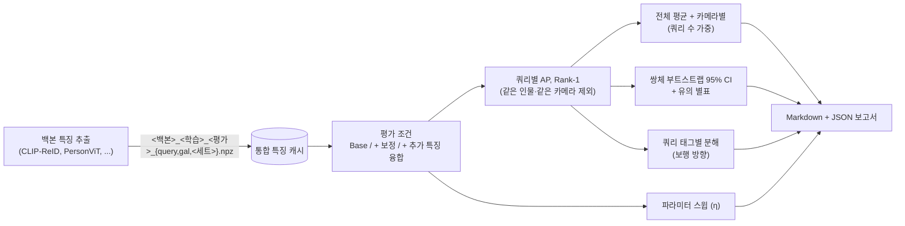

# reid-eval-bench

**한 줄 요약:** 여러 Re-ID 백본의 특징을 같은 형식으로 저장하고, 쿼리 단위 부트스트랩 신뢰구간과 카메라별·방향별 분해, 하이퍼파라미터 민감도, 결과 표 자동 생성(Markdown, JSON)을 제공하는 평가 도구.

[English README](README_en.md)



## 해결하는 문제

Re-ID 논문은 보통 설정마다 mAP·Rank-1 하나만 보고한다. 두 방법의 차이가 1점 미만일 때 그 차이가 우연인지, 어느 카메라에서 생긴 것인지, 하이퍼파라미터에 얼마나 민감한지 알기 어렵다. 백본이 여러 개면 백본마다 분석 스크립트가 따로 생기기 쉽다. 이 저장소는 특징 추출과 평가를 분리한다. 모든 백본이 같은 캐시 형식으로 저장하고, 테스트된 numpy 전용 함수 한 벌로 지표·신뢰구간·분해를 계산한다.

## 방법

| 단계 | 내용 | 코드 |
|---|---|---|
| 1. 통합 캐시 | `query`/`gal`: `feat (N, D)` 원시값, `pid`, `cam`, `name` / 추가 세트: `feat (P, K, D)` 원시값, `name`(대표 갤러리 사진) | `src/reidbench/io.py` |
| 2. 지표 | 코사인 유사도, 쿼리와 **같은 인물·같은 카메라**인 갤러리 제외, 쿼리별 Rank-1과 AP(비보간), 쿼리 평균 | `src/reidbench/metrics.py` |
| 3. 카메라별 | 쿼리 카메라별 평균 AP, 쿼리 수 가중 평균 = 전체 평균 검증 | `src/reidbench/breakdown.py` |
| 4. 유의성 | 쿼리별 AP 차이의 쌍체 부트스트랩(1000회, `RandomState(seed)`), 95% CI가 0을 포함하지 않으면 `*` | `src/reidbench/bootstrap.py` |
| 5. 태그별 분해 | 쿼리 태그(예: 정면·후면·사각·측면 보행 방향)마다 같은 쌍체 CI | `src/reidbench/breakdown.py` |
| 6. 평가 조건 | Base, 카메라 보정(카메라별 평균 특징 차감), 추가 특징 융합 `g' = N(N(g) + (η/K)·Σ_k N(e_k))` (공통 세트 또는 쿼리 카메라별 세트) | `src/reidbench/fusion.py`, `src/reidbench/conditions.py` |
| 7. 스윕 | 임의 파라미터, 융합계수 η 스윕 내장 | `src/reidbench/sweep.py` |
| 8. 보고서 | Markdown 표(mAP / R1, 별표 붙은 차이)와 모든 수치를 담은 JSON | `src/reidbench/report_md.py` |

**융합은 일반화되어 있다.** 아래 결과의 실험에서 추가 세트는 대표 갤러리 사진마다 생성한 K = 8장(Pose2ID IPG)의 특징이다. 하나는 *공통* 8자세 세트이고, 다른 하나는 카메라별 보행 방향 분포에 맞춘 *카메라별* 세트(방향 맞춤)다. 각 갤러리 항목은 카메라 보정된 특징 공간에서 가장 유사한 대표 사진의 세트를 받거나(`assign=sim`), 정답 인물이 같은 대표 사진의 세트를 받는다(`assign=oracle`, 상한). 카메라 *c*의 쿼리는 카메라 *c* 세트로 융합된 갤러리에서 검색한다. 다른 대표 사진별 특징 세트(증강, 다른 생성기)도 같은 방식으로 쓸 수 있다.

## 설치

```bash
git clone https://github.com/artelee/IndustrialAI.git
cd IndustrialAI/2026_석사논문_ReID_평가벤치
pip install -r requirements.txt      # numpy, pyyaml, pytest
pip install -e .                     # 선택: 어디서나 `import reidbench`
pytest                               # 테스트 16개, CPU, 1초 미만
```

## 데이터·특징 준비

* 데이터셋: [Market-1501](https://zheng-lab-anu.github.io/Project/project_reid.html), DukeMTMC-reID(저자들이 공개 중단, 사용 권한이 있는 사본만 사용), [MSMT17](https://www.pkuvmc.com/dataset.html). 공식 경로에서 각 라이선스에 따라 받는다. 이 저장소는 이미지를 배포하지 않는다.
* 백본·가중치: [CLIP-ReID](https://github.com/Syliz517/CLIP-ReID), [PersonViT](https://github.com/hustvl/PersonViT). 생성: [Pose2ID (IPG)](https://github.com/yuanc3/Pose2ID).
* 특징 추출은 백본마다 다르므로 포함하지 않는다. 추출기 출력을 `reidbench.io.save_split` / `save_set`으로 아래 이름에 맞춰 `data/features/`에 저장한다. 쿼리는 junk(pid -1)와 distractor(pid 0)를 빼고, 갤러리는 junk만 뺀다. 특징은 정규화하지 않고 저장한다.

```
data/features/<백본>_<학습>_<평가>_query.npz     feat (N, D), pid (N,), cam (N,), name (N,)
data/features/<백본>_<학습>_<평가>_gal.npz       feat (M, D), pid (M,), cam (M,), name (M,)
data/features/<백본>_<학습>_<평가>_<세트>.npz    feat (P, K, D), name (P,)   # 예: mkt_std, mkt_dm_c1..c6
data/tags/query_direction_<평가>.json            {"<쿼리 이미지 이름>": "front" | "back" | "oblique" | "side" | ...}
```

## 실행

합성 데이터 점검 실행 (데이터 불필요, 모든 스크립트, 몇 초):

```bash
python scripts/make_synthetic_cache.py --out outputs/synthetic_cache
python scripts/make_table.py  --config configs/smoke.yaml
python scripts/sweep_eta.py   --config configs/smoke.yaml
python scripts/query_tags.py  --config configs/smoke.yaml
```

실제 특징 (경로는 예시, 캐시는 읽기만 함):

```bash
# 쿼리·갤러리 한 쌍을 보정 없이/보정해서 평가한 뒤 쌍체 비교
python scripts/evaluate.py --query data/features/clip_duke_market_query.npz \
    --gallery data/features/clip_duke_market_gal.npz --out outputs/eval/base
python scripts/evaluate.py --calibrate --query data/features/clip_duke_market_query.npz \
    --gallery data/features/clip_duke_market_gal.npz --out outputs/eval/calib
python scripts/compare.py --a outputs/eval/base_per_query.npz --b outputs/eval/calib_per_query.npz \
    --out outputs/eval/base_vs_calib

# 한 백본의 전체 표 / η 스윕 / 방향별 분해
python scripts/make_table.py --cache-dir data/features --backbone clip            # outputs/final_table_clip.{json,md}
python scripts/sweep_eta.py  --cache-dir data/features --backbone clip            # outputs/eta_sweep_clip.{json,md}
python scripts/query_tags.py --cache-dir data/features --backbone clip --tag-dir data/tags
```

평가 함수를 직접 쓸 수도 있다. `metrics.py`, `bootstrap.py`는 numpy만 쓰므로 다른 프로젝트에 그대로 복사해도 된다.

```python
from reidbench.metrics import l2_normalize, evaluate_per_query
from reidbench.bootstrap import paired_bootstrap_ci, format_diff

res_a = evaluate_per_query(l2_normalize(qf), qp, qc, l2_normalize(gf), gp, gc)
res_b = evaluate_per_query(l2_normalize(qf), qp, qc, l2_normalize(gf2), gp, gc)
print(res_a.mAP, res_a.rank1)
print(format_diff(paired_bootstrap_ci(res_a.ap, res_b.ap, rng=0), with_ci=True))   # 예: +0.50* [+0.31, +0.69]
```

프로토콜 세부: AP는 정답 위치마다의 정밀도를 평균한 비보간 AP다. 흔히 쓰는 Python 재구현 방식이며, Market-1501 원본 MATLAB 코드의 사다리꼴 방식과는 다르다. 표 스크립트는 모든 쿼리에 대해 평균을 낸다. Market-1501과 DukeMTMC-reID는 모든 쿼리에 유효한 정답이 있다. `evaluate_per_query`는 `valid` 마스크를 함께 주고, 유효한 쿼리만으로 평균을 낸다.

## 폴더 구조

```
reid-eval-bench/
├── configs/
│   ├── default.yaml          # 데이터셋, 카메라, 세트 이름, 실험 목록, η, 부트스트랩 시드
│   └── smoke.yaml            # 합성 데이터 점검용
├── scripts/
│   ├── evaluate.py           # 쿼리·갤러리 한 쌍 -> R1, mAP, 카메라별, 쿼리별 점수
│   ├── compare.py            # evaluate.py 두 결과의 쌍체 부트스트랩 CI
│   ├── make_table.py         # 본문 표 (전 조건, 카메라별, CI) -> JSON + Markdown
│   ├── sweep_eta.py          # 융합계수 민감도
│   ├── query_tags.py         # 쿼리 보행 방향별 분해
│   └── make_synthetic_cache.py
├── src/reidbench/
│   ├── io.py                 # 통합 캐시 형식, 로더/저장, 태그 파일
│   ├── metrics.py            # l2_normalize, average_precision, evaluate_per_query (numpy 전용)
│   ├── bootstrap.py          # paired_bootstrap_ci, significance_star (numpy 전용)
│   ├── breakdown.py          # 카메라별, 가중 평균, 태그별 쌍체 CI
│   ├── fusion.py             # 카메라 보정, 추가 특징 융합, 대표 사진 배정
│   ├── conditions.py         # Base / 보정 / 공통·카메라별 융합 조건
│   ├── sweep.py              # 일반 스윕 + η 스윕
│   ├── report_md.py          # Markdown 표, JSON 저장
│   └── config.py
├── tests/                    # pytest (합성 데이터만 사용)
├── pyproject.toml
├── requirements.txt
└── LICENSE
```

## 인용 / 라이선스 / 관련 저장소

평가에 쓴 백본, 데이터, 생성기를 사용한다면 원 논문을 인용한다.

* CLIP-ReID: S. Li, L. Sun, Q. Li. *CLIP-ReID: Exploiting Vision-Language Model for Image Re-Identification without Concrete Text Labels.* AAAI 2023. (코드: MIT, (c) 2023 Syliz517)
* PersonViT: B. Hu et al. *PersonViT: Large-scale Self-supervised Vision Transformer for Person Re-Identification.* arXiv:2408.05398, 2024. (코드: Apache-2.0)
* Pose2ID: C. Yuan et al. *From Poses to Identity: Training-Free Person Re-Identification via Feature Centralization.* CVPR 2025. (코드: MIT, (c) 2025 yuanc3)
* Market-1501: L. Zheng et al. *Scalable Person Re-identification: A Benchmark.* ICCV 2015.
* DukeMTMC-reID: E. Ristani et al. ECCVW 2016; Z. Zheng et al. ICCV 2017.
* MSMT17: L. Wei et al. *Person Transfer GAN to Bridge Domain Gap for Person Re-Identification.* CVPR 2018.
* 부트스트랩: B. Efron. *Bootstrap Methods: Another Look at the Jackknife.* Annals of Statistics, 1979.

라이선스: MIT ([LICENSE](LICENSE)). 이 저장소에는 외부 코드, 데이터, 가중치, 특징이 들어 있지 않다.

관련 저장소:
[2026_석사논문_ReID_카메라특징보정](../2026_석사논문_ReID_카메라특징보정/) ·
[2026_석사논문_보행방향분석](../2026_석사논문_보행방향분석/) ·
[2026_석사논문_카메라별_자세선정](../2026_석사논문_카메라별_자세선정/) ·
[2026_석사논문_재현가능한_Diffusion생성](../2026_석사논문_재현가능한_Diffusion생성/) ·
[2026_석사논문_ReID_평가벤치](../2026_석사논문_ReID_평가벤치/) ·
[2026_석사논문_MSMT17_변환기](../2026_석사논문_MSMT17_변환기/)
