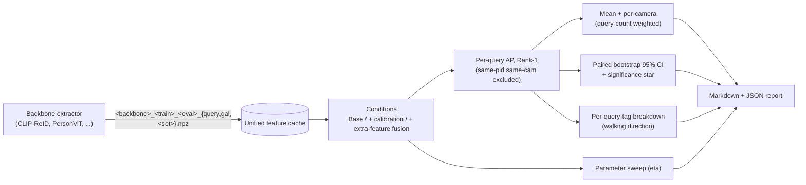

# reid-eval-bench

**One-line summary:** an evaluation bench that stores features of several Re-ID backbones in one common format and provides mean mAP / Rank-1, paired query-level bootstrap confidence intervals, per-camera and per-query-direction breakdowns, hyper-parameter sensitivity sweeps, and automatic result tables (Markdown, JSON).

[한국어 README](README_ko.md)



## Problem

Re-ID papers usually report a single mAP / Rank-1 number per setting. When two methods differ by a fraction of a point it is unclear whether the gain is real, which cameras it comes from, and how sensitive it is to hyper-parameters. Running the same analysis for several backbones also tends to produce one ad-hoc script per backbone. This repository separates feature extraction from evaluation: every backbone writes the same cache format, and one set of tested, numpy-only functions computes the metrics, confidence intervals and breakdowns.

## Method

| Step | What it does | Code |
|---|---|---|
| 1. Unified cache | `query`/`gal`: `feat (N, D)` raw, `pid`, `cam`, `name`; extra sets: `feat (P, K, D)` raw, `name` (reference gallery images) | `src/reidbench/io.py` |
| 2. Metrics | Cosine similarity; gallery items with the **same pid and same camera** as the query are removed; Rank-1 and non-interpolated AP per query; mean over queries | `src/reidbench/metrics.py` |
| 3. Per-camera | Mean AP per query camera; the query-count weighted mean is checked to equal the overall mean | `src/reidbench/breakdown.py` |
| 4. Significance | Paired query-level bootstrap (1000 resamples, `RandomState(seed)`) of the per-query AP difference; `*` when the 95% CI excludes 0 | `src/reidbench/bootstrap.py` |
| 5. Tag breakdown | The same paired CI within each query tag (e.g. front / back / oblique / side walking direction) | `src/reidbench/breakdown.py` |
| 6. Conditions | Base, camera calibration (subtract per-camera mean feature), extra-feature fusion `g' = N(N(g) + (eta/K) * sum_k N(e_k))` with a *common* set or a *per-query-camera* set | `src/reidbench/fusion.py`, `src/reidbench/conditions.py` |
| 7. Sweep | Any parameter; built-in eta sweep for the fusion weight | `src/reidbench/sweep.py` |
| 8. Report | Markdown tables (mAP / R1, diff with stars) and JSON with every number | `src/reidbench/report_md.py` |

**Fusion is generic.** In the experiments behind the results below, the extra sets are features of K = 8 images generated per reference gallery image (Pose2ID IPG): a *common* set of 8 poses, and a *per-camera* set whose poses follow the walking-direction distribution of each camera ("direction-aligned"). Each gallery item receives the set of the reference image it is most similar to in camera-calibrated feature space (`assign=sim`), or of the reference with the same ground-truth pid (`assign=oracle`, upper bound). A query from camera *c* is ranked against the gallery fused with camera *c*'s set. Any other per-reference feature set (augmentations, other generators) can be plugged in the same way.

## Install

```bash
git clone https://github.com/artelee/IndustrialAI.git
cd IndustrialAI/2026_석사논문_ReID_평가벤치
pip install -r requirements.txt      # numpy, pyyaml, pytest
pip install -e .                     # optional: makes `import reidbench` available everywhere
pytest                               # 16 tests, CPU only, < 1 s
```

## Data and features

* Datasets: [Market-1501](https://zheng-lab-anu.github.io/Project/project_reid.html), DukeMTMC-reID (withdrawn by its authors; only use a copy you are licensed to use), [MSMT17](https://www.pkuvmc.com/dataset.html). Obtain them from the official sources under their licenses. No images are distributed here.
* Backbones / weights: [CLIP-ReID](https://github.com/Syliz517/CLIP-ReID), [PersonViT](https://github.com/hustvl/PersonViT). Generated images: [Pose2ID (IPG)](https://github.com/yuanc3/Pose2ID).
* Feature extraction is backbone-specific and not part of this repo. Write your extractor's output with `reidbench.io.save_split` / `save_set` into `data/features/` using the file names below. Queries exclude junk (pid -1) and distractors (pid 0); the gallery excludes only junk; features are stored un-normalised.

```
data/features/<backbone>_<train>_<eval>_query.npz     feat (N, D), pid (N,), cam (N,), name (N,)
data/features/<backbone>_<train>_<eval>_gal.npz       feat (M, D), pid (M,), cam (M,), name (M,)
data/features/<backbone>_<train>_<eval>_<set>.npz     feat (P, K, D), name (P,)  # e.g. mkt_std, mkt_dm_c1..c6
data/tags/query_direction_<eval>.json                 {"<query image name>": "front" | "back" | "oblique" | "side" | ...}
```

## Run

Synthetic smoke run (no data needed, all scripts, a few seconds):

```bash
python scripts/make_synthetic_cache.py --out outputs/synthetic_cache
python scripts/make_table.py  --config configs/smoke.yaml
python scripts/sweep_eta.py   --config configs/smoke.yaml
python scripts/query_tags.py  --config configs/smoke.yaml
```

Real features (paths are placeholders; the cache is only read):

```bash
# one query/gallery pair, with and without calibration, then a paired comparison
python scripts/evaluate.py --query data/features/clip_duke_market_query.npz \
    --gallery data/features/clip_duke_market_gal.npz --out outputs/eval/base
python scripts/evaluate.py --calibrate --query data/features/clip_duke_market_query.npz \
    --gallery data/features/clip_duke_market_gal.npz --out outputs/eval/calib
python scripts/compare.py --a outputs/eval/base_per_query.npz --b outputs/eval/calib_per_query.npz \
    --out outputs/eval/base_vs_calib

# full table / eta sweep / per-direction breakdown for one backbone
python scripts/make_table.py --cache-dir data/features --backbone clip            # outputs/final_table_clip.{json,md}
python scripts/sweep_eta.py  --cache-dir data/features --backbone clip            # outputs/eta_sweep_clip.{json,md}
python scripts/query_tags.py --cache-dir data/features --backbone clip --tag-dir data/tags
```

Use the evaluation functions directly. `metrics.py` and `bootstrap.py` depend only on numpy and can be copied into other projects:

```python
from reidbench.metrics import l2_normalize, evaluate_per_query
from reidbench.bootstrap import paired_bootstrap_ci, format_diff

res_a = evaluate_per_query(l2_normalize(qf), qp, qc, l2_normalize(gf), gp, gc)
res_b = evaluate_per_query(l2_normalize(qf), qp, qc, l2_normalize(gf2), gp, gc)
print(res_a.mAP, res_a.rank1)
print(format_diff(paired_bootstrap_ci(res_a.ap, res_b.ap, rng=0), with_ci=True))   # e.g. +0.50* [+0.31, +0.69]
```

Protocol details: AP is the non-interpolated mean of precision at each true match (the common Python re-implementation, not the trapezoidal variant of the original Market-1501 MATLAB code). In the table scripts, the mean is taken over all queries; on Market-1501 and DukeMTMC-reID every query has a valid match. `evaluate_per_query` reports a `valid` mask and averages over valid queries.

## Folder structure

```
reid-eval-bench/
├── configs/
│   ├── default.yaml          # datasets, cameras, set names, experiments, eta, bootstrap seed
│   └── smoke.yaml            # synthetic smoke run
├── scripts/
│   ├── evaluate.py           # one query/gallery pair -> R1, mAP, per-camera, per-query scores
│   ├── compare.py            # paired bootstrap CI between two evaluate.py runs
│   ├── make_table.py         # main table (all conditions, per-camera, CIs) -> JSON + Markdown
│   ├── sweep_eta.py          # fusion-weight sensitivity
│   ├── query_tags.py         # per-query-direction breakdown
│   └── make_synthetic_cache.py
├── src/reidbench/
│   ├── io.py                 # unified cache format, loaders/savers, tag files
│   ├── metrics.py            # l2_normalize, average_precision, evaluate_per_query (numpy only)
│   ├── bootstrap.py          # paired_bootstrap_ci, significance_star (numpy only)
│   ├── breakdown.py          # per-camera, weighted mean, per-tag paired CIs
│   ├── fusion.py             # camera calibration, extra-feature fusion, reference assignment
│   ├── conditions.py         # Base / calibration / common / per-camera fusion conditions
│   ├── sweep.py              # generic sweep + eta sweep
│   ├── report_md.py          # Markdown tables, JSON writer
│   └── config.py
├── tests/                    # pytest (synthetic data only)
├── pyproject.toml
├── requirements.txt
└── LICENSE
```

## Citation, license, related repositories

If you use the evaluated backbones, data or generator, cite the original works:

* CLIP-ReID: S. Li, L. Sun, Q. Li. *CLIP-ReID: Exploiting Vision-Language Model for Image Re-Identification without Concrete Text Labels.* AAAI 2023. (code: MIT, (c) 2023 Syliz517)
* PersonViT: B. Hu et al. *PersonViT: Large-scale Self-supervised Vision Transformer for Person Re-Identification.* arXiv:2408.05398, 2024. (code: Apache-2.0)
* Pose2ID: C. Yuan et al. *From Poses to Identity: Training-Free Person Re-Identification via Feature Centralization.* CVPR 2025. (code: MIT, (c) 2025 yuanc3)
* Market-1501: L. Zheng et al. *Scalable Person Re-identification: A Benchmark.* ICCV 2015.
* DukeMTMC-reID: E. Ristani et al. ECCVW 2016; Z. Zheng et al. ICCV 2017.
* MSMT17: L. Wei et al. *Person Transfer GAN to Bridge Domain Gap for Person Re-Identification.* CVPR 2018.
* Bootstrap: B. Efron. *Bootstrap Methods: Another Look at the Jackknife.* Annals of Statistics, 1979.

License: MIT (see [LICENSE](LICENSE)). This repository contains no third-party code, data, weights or features.

Related repositories:
[2026_석사논문_ReID_카메라특징보정](../2026_석사논문_ReID_카메라특징보정/) ·
[2026_석사논문_보행방향분석](../2026_석사논문_보행방향분석/) ·
[2026_석사논문_카메라별_자세선정](../2026_석사논문_카메라별_자세선정/) ·
[2026_석사논문_재현가능한_Diffusion생성](../2026_석사논문_재현가능한_Diffusion생성/) ·
[2026_석사논문_ReID_평가벤치](../2026_석사논문_ReID_평가벤치/) ·
[2026_석사논문_MSMT17_변환기](../2026_석사논문_MSMT17_변환기/)
