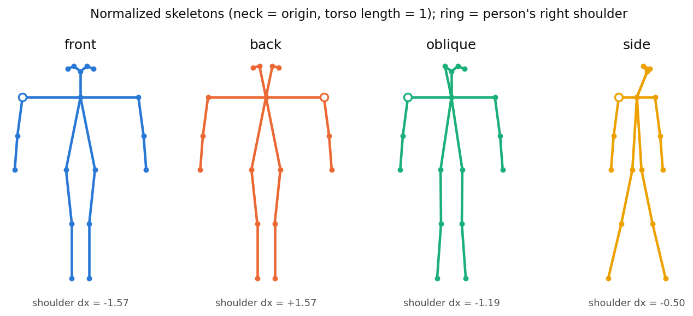

# walking-direction-analyzer

DWPose 포즈 추정으로 보행 방향(정면·후면·사각·측면)을 판정하고, 재식별(Re-ID) 갤러리의 카메라별 방향 분포와 카메라 내외 자세 변이를 분석·시각화한다.

[English README](README_en.md)

## 해결하는 문제

자세 기반 Re-ID 증강(갤러리 인물을 여러 자세로 생성하는 방식 등)은 보통 모든 카메라에 같은 자세 묶음을 쓴다. 그런데 카메라마다 사람이 렌즈 기준으로 걷는 방향이 달라서, 정면·후면·측면이 보이는 비율이 카메라마다 다르다. 이 저장소는 두 가지를 측정한다.

- 카메라마다 보행 방향 구성이 얼마나 다른가
- 자세 변이가 카메라 **사이**보다 카메라 **안**에서 더 큰가 (더 크다면 카메라당 대표 자세 하나로는 부족하다)

모든 분석은 키포인트 배열만으로 동작한다. DWPose는 키포인트를 한 번 뽑을 때만 필요하고, 뽑은 키포인트를 캐시해 두면 CPU에서 다시 분석할 수 있다.

## 방법

| 단계 | 내용 | 모듈 |
|---|---|---|
| 1. 키포인트 | DWPose(`controlnet_aux`)로 이미지마다 OpenPose 배치의 몸 관절 18개를 얻는다 (첫 번째 사람, 신뢰도 > 0.3이면 보이는 관절). | `walkdir/pose.py` |
| 2. 정규화 | 목을 원점으로 옮기고 좌표를 몸통 길이(목에서 골반까지)로 나눈다. 안 보이는 관절은 0으로 둔다. 결과는 36차원 자세 벡터다. | `walkdir/pose.py` |
| 3. 품질 필터 | 사유별로 탈락시킨다. `core`(관절 12개 미만, 또는 목·어깨·골반 누락), `halfbody`(발목 또는 머리 관절 없음), `small`(스켈레톤 높이가 이미지의 0.55 미만), `limb`(뼈 하나가 몸통의 1.6배 초과). `nodet`/`unknown`은 검출 실패와 방향 판정 불가를 센다. | `walkdir/quality.py` |
| 4. 방향 판정 | 어깨 폭 `w = abs(x_rs - x_ls)`(몸통 길이 단위)이 `q33` 미만이면 측면, `q33` 이상 `q66` 미만이면 사각이다. 그 이상이면 좌우 어깨 순서로 정면과 후면을 가른다 (사람의 오른어깨가 이미지 왼쪽이면 정면). `q33`/`q66`은 갤러리 어깨 폭의 1/3, 2/3 분위수다. | `walkdir/direction.py` |
| 5. 카메라별 비율 | 카메라별 방향 분포와 탈락 사유별 개수를 센다. | `walkdir/stats.py` |
| 6. 변이 | 카메라 내 변이는 카메라 자세들과 카메라 평균 사이 거리의 평균이다. 카메라 간 변이는 카메라 평균들 사이 거리의 평균이다. 둘 다 36차원 공간에서 잰다. | `walkdir/stats.py` |
| 7. 그림 | 통계로 방향 누적 막대와 변이 막대를 그리고, 스켈레톤만 있는 그림을 그린다. | `walkdir/plot.py` |



*합성 스켈레톤 (사람 이미지 없음). 어깨 폭으로 측면·사각·정면/후면을 나누고, 어깨 좌우 순서(동그라미가 사람의 오른어깨)로 정면과 후면을 나눈다. DWPose는 뒷모습에서도 눈을 자주 검출하므로 얼굴 관절은 쓰지 않는다.*

## 설치

```bash
git clone https://github.com/artelee/IndustrialAI.git
cd IndustrialAI/2026_석사논문_보행방향분석
pip install -r requirements.txt      # 핵심: numpy, matplotlib, pyyaml, pillow, pytest
pip install -e .                     # 선택: 어디서나 `import walkdir` 가능
pytest                               # CPU만 사용, 가중치 불필요
```

포즈 추출은 선택 사항이다. 아래 버전 조합을 Python 3.10, torch 2.1에서 확인했다.

```bash
pip install opencv-python mmengine==0.10.7 mmcv==2.1.0 mmdet==3.3.0 mmpose==1.3.2
pip install --no-deps controlnet_aux==0.0.10
```

### 데이터·가중치

- 데이터셋: [Market-1501](https://zheng-lab-anu.github.io/Project/project_reid.html), DukeMTMC-reID(저자들이 공개를 중단해 현재 배포되지 않음), [MSMT17](https://www.pkuvmc.com/dataset.html). 공식 경로에서 각 라이선스에 따라 받는다. MSMT17은 Market 형식 파일명(`0000_c14_....jpg`)을 가정한다. 이 저장소에는 이미지가 들어 있지 않다.
- DWPose 가중치는 처음 실행할 때 `controlnet_aux`가 자동으로 받는다: [dw-ll_ucoco_384](https://huggingface.co/wanghaofan/dw-ll_ucoco_384), [YOLOX-L](https://github.com/open-mmlab/mmdetection/tree/main/configs/yolox). 로컬 파일을 쓰려면 `configs/default.yaml`의 `pose.det_ckpt`, `pose.pose_ckpt`를 지정한다.

## 실행

```bash
# 1) DWPose로 키포인트를 추출해 분석 (키포인트는 outputs/keypoints_market.npz 에 캐시)
python scripts/analyze_cameras.py --gallery data/market1501/bounding_box_test --parser market --samples 500 --out outputs/
#    GPU 실행은 --device cuda, 다른 데이터셋은 --parser duke | msmt

# 2) 포즈 모델 없이 캐시한 키포인트로 다시 분석 (예: 기준값 변경)
python scripts/analyze_cameras.py --keypoints outputs/keypoints_market.npz --parser market --thresholds auto --out outputs/

# 3) 합성 스켈레톤으로 CPU 데모
python scripts/make_synthetic_keypoints.py --out outputs/keypoints_synthetic.npz
python scripts/analyze_cameras.py --keypoints outputs/keypoints_synthetic.npz --parser market --name synthetic --out outputs/

# 4) 요약 통계로 README 그림 다시 그리기
python scripts/make_readme_figures.py --stats docs/figures/figure_data.json --out docs/figures/
```

분석 결과는 `outputs/`에 아래 파일로 저장된다.

- `directions_<name>.json`, `.csv`: 카메라별 방향 비율, 탈락 사유, 기준값, 카메라 내외 변이
- `fig_directions_<name>.png`, `fig_variation_<name>.png`
- `keypoints_<name>.npz`: 원시 키포인트 (`--gallery`를 쓸 때만 생성)

`--thresholds`에는 `preset`(기본값, 위 표의 데이터셋별 값), `auto`(분석 표본의 3분위수), `q33,q66` 중 하나를 넣는다.

## 폴더 구조

```
walking-direction-analyzer/
├── configs/                  # default.yaml (필터·방향 기준값·포즈 모델), datasets.yaml (예시 경로)
├── docs/figures/             # README 그림 + figure_data.json (통계만)
├── scripts/                  # analyze_cameras.py, make_synthetic_keypoints.py, make_readme_figures.py
├── src/walkdir/              # pose, quality, direction, stats, plot, analysis, data, synthetic
└── tests/                    # pytest (CPU, 합성 키포인트)
```

`pose.py`, `quality.py`, `direction.py`는 numpy에만 의존한다 (`quality`는 `pose`를 import한다). 세 파일을 묶어서 다른 프로젝트에 그대로 복사해 쓸 수 있다.

## 인용·라이선스·관련 저장소

- DWPose: Z. Yang et al., *Effective Whole-body Pose Estimation with Two-stages Distillation*, ICCV Workshops 2023 (Apache-2.0)
- controlnet_aux (Hugging Face, Apache-2.0): DWPose 래퍼로 사용
- OpenPose 18관절 배치: Z. Cao et al., TPAMI 2019
- Market-1501: L. Zheng et al., ICCV 2015
- DukeMTMC-reID: E. Ristani et al., ECCV Workshops 2016; Z. Zheng et al., ICCV 2017
- MSMT17: L. Wei et al., CVPR 2018

라이선스: [MIT](LICENSE) (c) 2026 ehlee. 데이터셋과 포즈 모델 가중치는 각자의 라이선스를 따르며, 이 저장소에서 재배포하지 않는다.

관련 저장소:
- [2026_석사논문_ReID_평가벤치](../2026_석사논문_ReID_평가벤치/)
- [2026_석사논문_ReID_카메라특징보정](../2026_석사논문_ReID_카메라특징보정/)
- [2026_석사논문_보행방향분석](../2026_석사논문_보행방향분석/) (이 저장소)
- [2026_석사논문_재현가능한_Diffusion생성](../2026_석사논문_재현가능한_Diffusion생성/)
- [2026_석사논문_카메라별_자세선정](../2026_석사논문_카메라별_자세선정/)
- [2026_석사논문_MSMT17_변환기](../2026_석사논문_MSMT17_변환기/)
