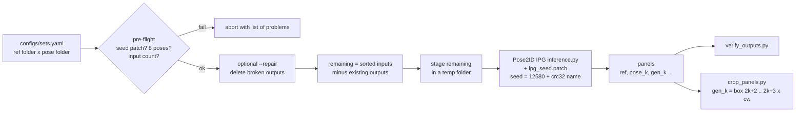

# reproducible-diffusion-generation

A wrapper that makes large-scale pose-conditioned image generation with **Pose2ID IPG** reproducible (a fixed seed per image) and robust (resume, pre-flight checks, broken-file repair, panel cropping).

[한국어 README](README_ko.md)



## Problem

Feature fusion with generated images only makes sense if the generated images can be reproduced and compared across pose sets. Stock IPG seeds the diffusion generator once per run, so the noise each image gets depends on its position in `os.listdir()` order. If a run is interrupted, if the folder holds a different subset, or if a different pose set is used, the same person gets different noise. Generating tens of thousands of panels (for example 3,060 MSMT17 identities x 16 pose sets, about 23 s each) also takes days, so the job has to survive crashes, skip finished work and catch half-written files.

## Method

| Step | What | Where |
|---|---|---|
| 1. Per-image seed | Right before each reference image, `generator.manual_seed(12580 + (zlib.crc32(ref_name.encode()) & 0x7fffffff))`. The seed depends only on the file name, so an image gets the same noise in any pose set (with the same number of poses), in any order and on re-runs | `patches/ipg_seed.patch`, `reprogen.seeding` |
| 2. Sorted inputs | `img_list = sorted(os.listdir(ref_dir))` gives a deterministic processing order | `patches/ipg_seed.patch` |
| 3. Set list + pre-flight | All runs are listed in one YAML file. Before anything starts, the tool checks that the seed patch is present in `inference.py` (`zlib.crc32`), that every pose folder holds exactly 8 files with integer-prefixed names (IPG's sort key), and that the input folders exist and have the expected count | `scripts/run_batch.py`, `reprogen.batch.preflight` |
| 4. Resume | An input counts as done when `<out>/<ref name>` exists. The remaining inputs are linked into a staging folder and IPG runs only on those. Re-running the same command continues where it stopped | `reprogen.batch.remaining_inputs`, `stage_inputs` |
| 5. Broken-file check | Zero-byte, truncated or undecodable outputs, plus panels whose width is not 17 columns, are reported and can be deleted (`--repair` / `--delete`), so a resume regenerates them | `scripts/verify_outputs.py`, `reprogen.verify` |
| 6. Panel to images | IPG saves `ref, pose_0, gen_0, ..., pose_7, gen_7` (17 columns, `cw = W // 17`). Generated image k is the box `((2k+2)*cw, 0, (2k+3)*cw, H)` | `scripts/crop_panels.py`, `reprogen.crop` |

The original-resolution saving (optional item 7 in the design) is **not** included. The original runs saved only the 128x256 panels, and a separate patch for it was never used or validated.

## Install

```bash
git clone https://github.com/artelee/IndustrialAI.git
cd IndustrialAI/2026_석사논문_재현가능한_Diffusion생성
pip install -r requirements.txt        # or: pip install -e ".[test]"
pytest                                 # CPU only, synthetic images
```

### Pose2ID IPG (not included, install from upstream and apply the patch)

This repository does **not** redistribute Pose2ID source code. It ships only a patch and these install steps. Pose2ID is MIT-licensed (Copyright (c) 2025 yuanc3), so distributing a patch against it is permitted; keep their license notice when you use the patched files.

```bash
mkdir -p third_party && cd third_party
git clone https://github.com/yuanc3/Pose2ID
cd Pose2ID
git apply ../../patches/ipg_seed.patch                 # required: per-image seed + sorted inputs
git apply ../../patches/ipg_pose_order_pillow.patch    # recommended, see below
cd IPG
# Environment, following the upstream README: conda create -n IPG python=3.9; pip install -r requirements.txt
```

- `patches/ipg_seed.patch` is the exact `diff -u` between the unmodified and the modified `IPG/inference.py` used in the original experiments. It applies cleanly to upstream commit `0fea3b3` (one hunk at a -2 line offset).
- `patches/ipg_pose_order_pillow.patch` contains two small fixes that were already in the local baseline: (a) poses are read in numeric file-name order (`1.png ... 8.png`), so `gen_k` in a panel always belongs to pose k (upstream uses unsorted `os.listdir`); (b) `Image.ANTIALIAS`, which was removed in Pillow 10, is replaced by `Image.LANCZOS`. The two patches apply in either order.
- Weights (links only): [IPG pretrained (HuggingFace)](https://huggingface.co/yuanc3/Pose2ID), [stable-diffusion-v1-5](https://huggingface.co/stable-diffusion-v1-5/stable-diffusion-v1-5), [sd-vae-ft-mse](https://huggingface.co/stabilityai/sd-vae-ft-mse). Set `base_model_path` and `vae_model_path` in `IPG/configs/inference.yaml`.

### Data

Reference images come from Market-1501, DukeMTMC-reID and MSMT17. Obtain them from the official sources under their licenses. DukeMTMC-reID has been withdrawn by its authors. No dataset images are included here. Pose folders hold 8 skeleton images each (IPG's `standard_poses`, or per-camera sets drawn with DWPose-style 18-keypoint skeletons).

## Run

Edit the placeholder paths in `configs/sets.yaml` first.

```bash
# check everything and print the plan (nothing is generated)
python scripts/run_batch.py --config configs/sets.yaml --dry-run

# run (resumable: run the same command again after an interruption)
python scripts/run_batch.py --config configs/sets.yaml \
    --python /path/to/envs/pose2id/bin/python --sets mkt_std duke_std --repair

# check / clean outputs, then cut panels into 8 images each
python scripts/verify_outputs.py outputs/gen_seed/mkt_std --num-poses 8 [--delete]
python scripts/crop_panels.py outputs/gen_seed/mkt_std outputs/crops/mkt_std
```

### Try it without data or a GPU

`scripts/make_demo.py` builds a synthetic workspace: noise "reference" images, solid-colour "poses" and a stand-in `inference.py` that has the same CLI and the same seed line and writes noise panels.

```bash
python scripts/make_demo.py outputs/demo
python scripts/run_batch.py --config outputs/demo/sets_demo.yaml --dry-run
python scripts/run_batch.py --config outputs/demo/sets_demo.yaml      # generates 3 sets x 5 panels
python scripts/run_batch.py --config outputs/demo/sets_demo.yaml      # resume: remaining 0
python scripts/verify_outputs.py outputs/demo/gen_seed/demo_std --num-poses 8
python scripts/crop_panels.py outputs/demo/gen_seed/demo_std outputs/demo/crops/demo_std
```

`tests/test_batch.py::test_run_batch_end_to_end_resume` runs this flow, deletes one panel and truncates another, resumes with `--repair` and checks that the regenerated files are byte-identical.

## Layout

```
reproducible-diffusion-generation/
├── patches/
│   ├── ipg_seed.patch                 # per-image seed + sorted inputs (diff of IPG/inference.py)
│   └── ipg_pose_order_pillow.patch    # numeric pose order + Pillow>=10 fix
├── configs/sets.yaml                  # IPG location + list of generation sets (placeholders)
├── src/reprogen/
│   ├── seeding.py                     # image_seed(name) = 12580 + (crc32(name) & 0x7fffffff)
│   ├── sets.py                        # YAML -> BatchConfig / GenSet ({cam} expansion)
│   ├── batch.py                       # pre-flight, remaining list, staging, IPG subprocess
│   ├── verify.py                      # broken-image detection / removal
│   ├── crop.py                        # panel column boxes, cropping
│   └── demo.py                        # synthetic workspace + stand-in IPG
├── scripts/
│   ├── run_batch.py
│   ├── verify_outputs.py
│   ├── crop_panels.py
│   └── make_demo.py
└── tests/                             # pytest, synthetic images only
```

## Citation, license and related repositories

- Pose2ID / IPG: C. Yuan, G. Zhang, C. Ma, T. Zhang, G. Niu, "From Poses to Identity: Training-Free Person Re-Identification via Feature Centralization", CVPR 2025. [arXiv:2503.00938](https://arxiv.org/abs/2503.00938), [code](https://github.com/yuanc3/Pose2ID) (MIT, Copyright (c) 2025 yuanc3).
- Stable Diffusion: R. Rombach et al., "High-Resolution Image Synthesis with Latent Diffusion Models", CVPR 2022.
- DWPose: Z. Yang et al., "Effective Whole-body Pose Estimation with Two-stages Distillation", ICCV 2023 Workshops (Apache-2.0).
- Market-1501: L. Zheng et al., ICCV 2015. DukeMTMC-reID: E. Ristani et al., ECCV 2016 Workshops; Z. Zheng et al., ICCV 2017. MSMT17: L. Wei et al., CVPR 2018.

License: MIT (see `LICENSE`). The patches modify MIT-licensed Pose2ID code. Pose2ID's own files are not included.

Related repositories:
[2026_석사논문_ReID_평가벤치](../2026_석사논문_ReID_평가벤치/) ·
[2026_석사논문_ReID_카메라특징보정](../2026_석사논문_ReID_카메라특징보정/) ·
[2026_석사논문_보행방향분석](../2026_석사논문_보행방향분석/) ·
[2026_석사논문_카메라별_자세선정](../2026_석사논문_카메라별_자세선정/) ·
[2026_석사논문_재현가능한_Diffusion생성](../2026_석사논문_재현가능한_Diffusion생성/) ·
[2026_석사논문_MSMT17_변환기](../2026_석사논문_MSMT17_변환기/)
