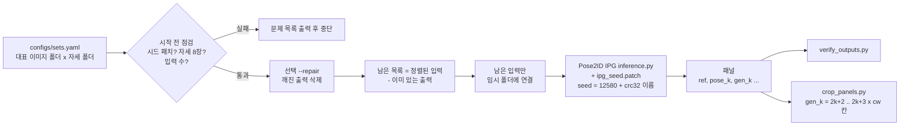

# reproducible-diffusion-generation

**Pose2ID IPG**로 자세 조건 이미지를 대량 생성할 때 재현성(이미지별 시드 고정)과 안정성(이어하기, 시작 전 점검, 깨진 파일 복구, 패널 잘라내기)을 확보하는 래퍼입니다.

[English README](README.md)



## 해결하는 문제

생성 이미지 특징을 융합하려면 생성 결과를 재현할 수 있어야 하고, 자세 세트끼리 비교할 수 있어야 합니다. 원본 IPG는 실행할 때 시드를 한 번만 고정합니다. 그래서 각 이미지가 받는 잡음이 `os.listdir()` 순서에서 몇 번째인지에 따라 달라집니다. 작업이 중간에 끊기거나, 폴더에 든 이미지 구성이 다르거나, 다른 자세 세트를 쓰면 같은 인물도 다른 잡음을 받습니다. 또 수만 장의 패널을 만드는 데에는 며칠이 걸립니다(예: MSMT17 3,060명 x 16세트, 장당 약 23초). 따라서 중단돼도 이어서 실행되고, 끝난 이미지는 건너뛰고, 덜 써진 파일은 걸러내야 합니다.

## 방법

| 단계 | 내용 | 위치 |
|---|---|---|
| 1. 이미지별 시드 | 대표 이미지마다 생성 직전에 `generator.manual_seed(12580 + (zlib.crc32(ref_name.encode()) & 0x7fffffff))`를 호출합니다. 시드가 파일 이름으로만 정해지므로, 자세 수가 같으면 어느 자세 세트에서든, 어떤 순서로 처리하든, 다시 실행하든 같은 잡음을 씁니다 | `patches/ipg_seed.patch`, `reprogen.seeding` |
| 2. 입력 순서 정렬 | `img_list = sorted(os.listdir(ref_dir))`로 처리 순서를 고정합니다 | `patches/ipg_seed.patch` |
| 3. 세트 목록과 시작 전 점검 | 모든 실행을 YAML 하나에 적습니다. 시작하기 전에 `inference.py`에 시드 패치(`zlib.crc32`)가 있는지, 자세 폴더마다 정수로 시작하는 이름의 파일이 정확히 8개인지(IPG 정렬 키), 입력 폴더가 있고 장수가 맞는지 확인합니다 | `scripts/run_batch.py`, `reprogen.batch.preflight` |
| 4. 이어하기 | `<출력>/<대표 이미지 이름>` 파일이 있으면 완료로 봅니다. 남은 입력만 임시 폴더에 연결해 IPG를 실행하므로, 같은 명령을 다시 실행하면 멈춘 곳부터 이어집니다 | `reprogen.batch.remaining_inputs`, `stage_inputs` |
| 5. 깨진 파일 검사 | 0바이트·잘린 파일, 디코딩이 안 되는 파일, 폭이 17칸이 아닌 패널을 보고하고 삭제할 수 있습니다(`--repair` / `--delete`). 삭제된 파일은 이어하기 때 다시 생성됩니다 | `scripts/verify_outputs.py`, `reprogen.verify` |
| 6. 패널에서 개별 이미지 추출 | IPG 패널은 `ref, pose_0, gen_0, ..., pose_7, gen_7` 순서의 17칸입니다(`cw = W // 17`). k번째 생성 이미지는 `((2k+2)*cw, 0, (2k+3)*cw, H)` 영역입니다 | `scripts/crop_panels.py`, `reprogen.crop` |

원본 해상도 저장(설계의 선택 항목 7)은 **넣지 않았습니다**. 원래 실험에서는 128x256 패널만 저장했고, 원본 해상도 저장용 패치는 실제로 쓰거나 검증한 적이 없습니다.

## 설치

```bash
git clone https://github.com/artelee/IndustrialAI.git
cd IndustrialAI/2026_석사논문_재현가능한_Diffusion생성
pip install -r requirements.txt        # 또는 pip install -e ".[test]"
pytest                                 # CPU, 합성 이미지만 사용
```

### Pose2ID IPG (포함하지 않음: 원 저장소에서 받아 패치 적용)

이 저장소는 Pose2ID 원 코드를 **재배포하지 않습니다**. 패치와 설치 안내만 제공합니다. Pose2ID는 MIT 라이선스(Copyright (c) 2025 yuanc3)이므로 패치를 배포해도 됩니다. 패치를 적용한 파일을 쓸 때는 원 라이선스 고지를 유지하세요.

```bash
mkdir -p third_party && cd third_party
git clone https://github.com/yuanc3/Pose2ID
cd Pose2ID
git apply ../../patches/ipg_seed.patch                 # 필수: 이미지별 시드 + 입력 정렬
git apply ../../patches/ipg_pose_order_pillow.patch    # 권장 (아래 설명)
cd IPG
# 환경 구성은 원 README를 따릅니다: conda create -n IPG python=3.9; pip install -r requirements.txt
```

- `patches/ipg_seed.patch`는 원래 실험에 쓴 `IPG/inference.py` 수정본과 수정 전 파일의 `diff -u`를 그대로 담고 있습니다. upstream 커밋 `0fea3b3`에 깨끗이 적용됩니다(hunk 하나가 2줄 앞에 적용됨).
- `patches/ipg_pose_order_pillow.patch`에는 수정 전 기준 파일에 이미 들어 있던 작은 수정 두 개가 있습니다. (a) 자세를 파일 이름의 숫자 순서(`1.png ... 8.png`)로 읽습니다. 그래서 패널의 `gen_k`는 항상 k번째 자세에 대응합니다(원본은 정렬하지 않은 `os.listdir`를 씁니다). (b) Pillow 10에서 제거된 `Image.ANTIALIAS`를 `Image.LANCZOS`로 바꿉니다. 두 패치는 어느 순서로 적용해도 됩니다.
- 가중치(링크만 안내): [IPG pretrained (HuggingFace)](https://huggingface.co/yuanc3/Pose2ID), [stable-diffusion-v1-5](https://huggingface.co/stable-diffusion-v1-5/stable-diffusion-v1-5), [sd-vae-ft-mse](https://huggingface.co/stabilityai/sd-vae-ft-mse). `IPG/configs/inference.yaml`의 `base_model_path`와 `vae_model_path`를 설정하세요.

### 데이터

대표 이미지는 Market-1501, DukeMTMC-reID, MSMT17에서 가져옵니다. 각 데이터셋은 공식 배포처에서 해당 라이선스에 따라 받으세요. DukeMTMC-reID는 저자들이 공개를 중단했습니다. 이 저장소에는 데이터셋 이미지가 없습니다. 자세 폴더에는 스켈레톤 그림이 8장씩 들어 있습니다(IPG의 `standard_poses`, 또는 DWPose 방식의 18관절 스켈레톤으로 그린 카메라별 세트).

## 실행

먼저 `configs/sets.yaml`의 예시 경로를 실제 경로로 바꾸세요.

```bash
# 점검하고 실행 계획만 출력 (생성하지 않음)
python scripts/run_batch.py --config configs/sets.yaml --dry-run

# 실행 (중단되면 같은 명령을 다시 실행해 이어서 진행)
python scripts/run_batch.py --config configs/sets.yaml \
    --python /path/to/envs/pose2id/bin/python --sets mkt_std duke_std --repair

# 출력 점검·정리 후 패널을 8장씩 잘라내기
python scripts/verify_outputs.py outputs/gen_seed/mkt_std --num-poses 8 [--delete]
python scripts/crop_panels.py outputs/gen_seed/mkt_std outputs/crops/mkt_std
```

### 데이터·GPU 없이 시험해 보기

`scripts/make_demo.py`는 합성 작업 폴더를 만듭니다. 잡음 "대표 이미지", 단색 "자세" 이미지, 그리고 대체 `inference.py`가 들어 있습니다. 대체 스크립트는 IPG와 같은 명령줄 인자와 같은 시드 줄을 쓰고, 잡음 패널을 저장합니다.

```bash
python scripts/make_demo.py outputs/demo
python scripts/run_batch.py --config outputs/demo/sets_demo.yaml --dry-run
python scripts/run_batch.py --config outputs/demo/sets_demo.yaml      # 3세트 x 5패널 생성
python scripts/run_batch.py --config outputs/demo/sets_demo.yaml      # 이어하기: 남은 0
python scripts/verify_outputs.py outputs/demo/gen_seed/demo_std --num-poses 8
python scripts/crop_panels.py outputs/demo/gen_seed/demo_std outputs/demo/crops/demo_std
```

`tests/test_batch.py::test_run_batch_end_to_end_resume`가 이 흐름을 실행합니다. 패널 하나를 지우고 다른 하나를 잘라 망가뜨린 뒤 `--repair`로 이어하기를 하고, 다시 만든 파일이 바이트 단위로 같은지 확인합니다.

## 폴더 구조

```
reproducible-diffusion-generation/
├── patches/
│   ├── ipg_seed.patch                 # 이미지별 시드 + 입력 정렬 (IPG/inference.py diff)
│   └── ipg_pose_order_pillow.patch    # 자세 숫자 순서 + Pillow>=10 호환
├── configs/sets.yaml                  # IPG 위치 + 생성 세트 목록 (예시 경로)
├── src/reprogen/
│   ├── seeding.py                     # image_seed(name) = 12580 + (crc32(name) & 0x7fffffff)
│   ├── sets.py                        # YAML -> BatchConfig / GenSet ({cam} 확장)
│   ├── batch.py                       # 시작 전 점검, 남은 목록, 임시 폴더, IPG 실행
│   ├── verify.py                      # 깨진 이미지 검사·삭제
│   ├── crop.py                        # 패널 칸 좌표, 잘라내기
│   └── demo.py                        # 합성 작업 폴더 + 대체 IPG
├── scripts/
│   ├── run_batch.py
│   ├── verify_outputs.py
│   ├── crop_panels.py
│   └── make_demo.py
└── tests/                             # pytest, 합성 이미지만 사용
```

## 인용, 라이선스, 관련 저장소

- Pose2ID / IPG: C. Yuan, G. Zhang, C. Ma, T. Zhang, G. Niu, "From Poses to Identity: Training-Free Person Re-Identification via Feature Centralization", CVPR 2025. [arXiv:2503.00938](https://arxiv.org/abs/2503.00938), [코드](https://github.com/yuanc3/Pose2ID) (MIT, Copyright (c) 2025 yuanc3)
- Stable Diffusion: R. Rombach et al., "High-Resolution Image Synthesis with Latent Diffusion Models", CVPR 2022
- DWPose: Z. Yang et al., "Effective Whole-body Pose Estimation with Two-stages Distillation", ICCV 2023 Workshops (Apache-2.0)
- Market-1501: L. Zheng et al., ICCV 2015 / DukeMTMC-reID: E. Ristani et al., ECCV 2016 Workshops; Z. Zheng et al., ICCV 2017 / MSMT17: L. Wei et al., CVPR 2018

라이선스: MIT (`LICENSE` 참고). 패치는 MIT 라이선스인 Pose2ID 코드를 수정하며, Pose2ID 파일 자체는 포함하지 않습니다.

관련 저장소:
[2026_석사논문_ReID_평가벤치](../2026_석사논문_ReID_평가벤치/) ·
[2026_석사논문_ReID_카메라특징보정](../2026_석사논문_ReID_카메라특징보정/) ·
[2026_석사논문_보행방향분석](../2026_석사논문_보행방향분석/) ·
[2026_석사논문_카메라별_자세선정](../2026_석사논문_카메라별_자세선정/) ·
[2026_석사논문_재현가능한_Diffusion생성](../2026_석사논문_재현가능한_Diffusion생성/) ·
[2026_석사논문_MSMT17_변환기](../2026_석사논문_MSMT17_변환기/)
