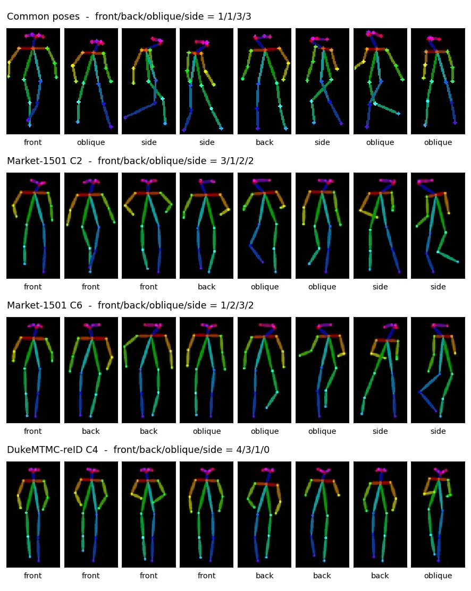

# camera-aware-pose-selection

카메라마다 보행 방향 분포에 맞춰 생성용 대표 자세 8개를 선정하고, 생성 모델의 기준 자세와 똑같은 방식으로 스켈레톤 이미지를 그립니다.



*스켈레톤만 표시. 맨 위: Pose2ID IPG의 공통 기준 8자세(정면/후면/사각/측면 = 1/1/3/3).
아래: 이 저장소가 선정·렌더링한 카메라별 자세 — Market-1501 C2(3/1/2/2), Market-1501 C6(1/2/3/2),
DukeMTMC-reID C4(4/3/1/0, 이 카메라에는 측면이 거의 없음).*

[English README](README.md)

## 해결하는 문제

Pose2ID 방식의 특징 중심화는 갤러리 인물을 여러 자세로 생성해 그 특징을 갤러리 특징에 융합합니다.
그런데 공통 자세는 모든 카메라에 똑같이 쓰이는 반면, 카메라마다 사람이 지나가는 방향은 크게 다릅니다
(복도 카메라는 정면·후면 위주, 길 옆 카메라는 측면 위주). 그 카메라에 거의 나오지 않는 자세는
쿼리와 맞지 않는 특징을 더합니다. 이 저장소는 카메라의 방향 구성을 따르도록 자세를 고르고,
기준 자세와 같은 형식으로 그려서 생성 모델의 다른 부분을 바꾸지 않고 그대로 교체할 수 있게 합니다.

## 방법

| 단계 | 내용 | 모듈 |
|---|---|---|
| 1 | 카메라별 갤러리 최대 500장 표본 → DWPose 키포인트 → 품질 필터 → 목·몸통 기준 정규화 | `posecore/` (walking-direction-analyzer에서 복사) |
| 2 | 자세별 보행 방향: 어깨 폭(몸통 길이 단위)을 데이터셋 분위수 `q33`/`q66`와 비교 → 측면/사각/정면·후면, 정면·후면은 좌우 어깨 순서로 구분 | `posecore/direction.py` |
| 3 | **배분**: 8개를 방향 비율에 비례해 배분. 표본이 5개 이상인 방향은 최소 1개, 그보다 드문 방향은 0개. 합이 8이 되도록 가장 많이 받은 방향에서 빼고 / 가장 적게 받은 방향에 더함 | `allocate.py` |
| 4 | **방향별 K-means**(k = 그 방향의 배분 수), 36차원 정규화 자세 벡터. 각 군집 중심에 **가장 가까운 실제 자세**를 선정 | `select.py` |
| 5 | **기준 자세와 맞춘 렌더링**: 자세의 위 끝·아래 끝·가로 중심을 기준 자세의 중앙값 배치에 맞춤(종횡비 유지) → OpenPose `draw_bodypose`, 320 x 160 캔버스 → LANCZOS로 **64 x 128 (가로 x 세로)** 축소 → RGB 배열을 그대로 `cv2.imwrite` = **BGR 순서로 저장**(기준 파일과 동일, 생성 모델은 `cv2.imread` + `Image.fromarray`로 읽음) | `render.py` |
| 6 | 확인 그림: 공통 자세와 카메라별 자세를 나란히(스켈레톤만) | `compare.py` |

방향 순서는 어디서나 **정면(front) / 후면(back) / 사각(oblique) / 측면(side)** 입니다(배분 표기, JSON, 동률 처리).
Pose2ID 공통 자세 1~8의 방향은 front, oblique, side, side, back, side, oblique, oblique
(`configs/common_poses.yaml`), 즉 1/1/3/3 입니다.

## 설치

```bash
pip install -r requirements.txt      # 또는: pip install -e .
pytest                               # CPU만 사용
```

Python 3.10. 핵심 기능(배분, 선정, 렌더링, 그림)은 numpy, scikit-learn, OpenCV, Pillow, matplotlib,
PyYAML만 필요합니다. 렌더링은 controlnet_aux가 있으면 그 `draw_bodypose`를, 없으면 동일한 내장 복사본을 씁니다.

갤러리 이미지에서 키포인트를 뽑으려면(선택) controlnet_aux를 통한 DWPose가 필요합니다.

```bash
pip install --no-deps controlnet_aux==0.0.10
pip install torch mmengine==0.10.7 mmcv==2.1.0 mmdet==3.3.0 mmpose==1.3.2
```

### 데이터·가중치

- Market-1501, DukeMTMC-reID(저자가 공개 중단, 이미 정식으로 받은 사본이 있을 때만 사용), MSMT17:
  각 공식 출처에서 해당 라이선스에 따라 받으세요. `configs/*.yaml`의 경로는 예시(`data/market1501/bounding_box_test` 등)입니다.
- DWPose / YOLOX 가중치는 controlnet_aux가 처음 실행할 때 내려받습니다 (DWPose: https://github.com/IDEA-Research/DWPose).
- Pose2ID IPG의 기준 자세(`standard_poses/`): https://github.com/yuanc3/Pose2ID

## 실행

```bash
# 1) 갤러리 이미지에서 카메라별 8자세 선정 (DWPose CPU 실행, GPU는 --device cuda)
python scripts/select_poses.py --config configs/market.yaml \
    --gallery data/market1501/bounding_box_test --out outputs/selection/market \
    --save-keypoints outputs/keypoints/market.json

#    ... 또는 저장된 키포인트 JSON에서 (자세 모델 불필요)
python scripts/select_poses.py --config configs/market.yaml \
    --keypoints outputs/keypoints/market.json --out outputs/selection/market

# 2) 기준 자세와 같은 방식으로 렌더링 -> outputs/poses/market/c<cam>/<k>.jpg
python scripts/render_poses.py --selection outputs/selection/market --out outputs/poses/market
#    (선택) 기준 배치 다시 측정: --reference-dir path/to/Pose2ID/IPG/standard_poses

# 3) 확인 그림: 공통 자세 vs 카메라별 자세
python scripts/compare_poses.py --common-dir path/to/Pose2ID/IPG/standard_poses \
    --camera "Market C2=outputs/poses/market/c2,outputs/selection/market/c2.json" \
    --camera "Market C6=outputs/poses/market/c6,outputs/selection/market/c6.json" \
    --out outputs/compare_market.png

# 합성 스켈레톤 CPU 데모 (데이터셋·자세 모델 불필요)
python scripts/make_synthetic_keypoints.py --out outputs/demo/keypoints.json
python scripts/select_poses.py --config configs/market.yaml \
    --keypoints outputs/demo/keypoints.json --out outputs/demo/selection
python scripts/render_poses.py --selection outputs/demo/selection --out outputs/demo/poses
python scripts/compare_poses.py \
    --camera "Demo C2=outputs/demo/poses/c2,outputs/demo/selection/c2.json" \
    --camera "Demo C3=outputs/demo/poses/c3,outputs/demo/selection/c3.json" \
    --out outputs/demo/compare.png
```

렌더링된 `outputs/poses/<dataset>/c<cam>/` 폴더를 그 카메라 갤러리 이미지의 생성용 자세 폴더로 씁니다.
각 `c<cam>.json`에는 방향 비율, 배분, 탈락 사유별 개수, 선정 자세와 키포인트가 저장됩니다.

## 폴더 구조

```
camera-aware-pose-selection/
├── configs/
│   ├── market.yaml, duke.yaml, msmt.yaml   # 갤러리 경로 예시, 카메라, 방향 기준값, K, seed
│   ├── render.yaml                         # 캔버스 320, 64x128, 기준 배치, 그리기 백엔드
│   └── common_poses.yaml                   # 공통 기준 8자세의 방향
├── docs/figures/common_vs_camera_poses.png
├── scripts/
│   ├── select_poses.py                     # 표본 -> 키포인트 -> 배분 -> K-means
│   ├── render_poses.py                     # 기준 자세와 맞춘 렌더링 (BGR 파일)
│   ├── compare_poses.py                    # 나란히 비교 그림
│   └── make_synthetic_keypoints.py         # CPU 데모 입력
├── src/campose/
│   ├── allocate.py                         # 방향 비율 -> 8자세 배분
│   ├── select.py                           # 방향별 K-means, 중심에 가장 가까운 실제 자세
│   ├── render.py                           # place / render_rgb / save_like_reference / draw_bodypose
│   ├── compare.py                          # 비교 그림
│   ├── data.py                             # 파일명 파서, 표본 추출, 키포인트 JSON
│   ├── synthetic.py                        # 합성 스켈레톤 (테스트, 데모)
│   └── posecore/                           # pose.py, quality.py, direction.py (walking-direction-analyzer에서 복사)
└── tests/
```

## 인용·라이선스·관련 저장소

- Pose2ID: C. Yuan et al. *From Poses to Identity: Training-Free Person Re-Identification via Feature Centralization.* CVPR 2025.
  https://github.com/yuanc3/Pose2ID (MIT, (c) 2025 yuanc3). 대표 그림 맨 위 줄은 이 저장소의 기준 자세(스켈레톤) 이미지입니다.
- DWPose: Z. Yang, A. Zeng, C. Yuan, Y. Li. *Effective Whole-body Pose Estimation with Two-stages Distillation.* ICCV Workshops 2023. Apache-2.0.
- OpenPose: Z. Cao et al. *OpenPose: Realtime Multi-Person 2D Pose Estimation using Part Affinity Fields.* TPAMI 2019 (18관절 신체 배치와 스켈레톤 그리기 방식).
- controlnet_aux (Hugging Face), Apache-2.0: DWPose 래퍼. `campose/render.py::draw_bodypose_builtin`은
  그 `dwpose/util.py::draw_bodypose`(ControlNet, pytorch-openpose에서 유래)를 픽셀 단위 동일 출력을 위해 그대로 복사한 것입니다.
- CLIP-ReID: S. Li, L. Sun, Q. Li. *CLIP-ReID: Exploiting Vision-Language Model for Image Re-Identification without Concrete Text Labels.* AAAI 2023.
  https://github.com/Syliz517/CLIP-ReID (MIT, (c) 2023 Syliz517). 결과 수치의 Re-ID 모델.
- Market-1501: L. Zheng et al. ICCV 2015. DukeMTMC-reID: E. Ristani et al. ECCV Workshops 2016; Z. Zheng et al. ICCV 2017. MSMT17: L. Wei et al. CVPR 2018.

라이선스: [MIT](LICENSE) (c) 2026 ehlee. 단, 복사한 `draw_bodypose`는 Apache-2.0(`src/campose/render.py` 머리말 참고).
데이터셋, 자세 모델 가중치, Pose2ID 기준 자세는 각자의 라이선스를 따르며 재배포하지 않습니다(위 스켈레톤 그림 제외).

관련 저장소:
- [2026_석사논문_ReID_평가벤치](../2026_석사논문_ReID_평가벤치/)
- [2026_석사논문_ReID_카메라특징보정](../2026_석사논문_ReID_카메라특징보정/)
- [2026_석사논문_보행방향분석](../2026_석사논문_보행방향분석/)
- [2026_석사논문_재현가능한_Diffusion생성](../2026_석사논문_재현가능한_Diffusion생성/)
- [2026_석사논문_카메라별_자세선정](../2026_석사논문_카메라별_자세선정/) (이 저장소)
- [2026_석사논문_MSMT17_변환기](../2026_석사논문_MSMT17_변환기/)
